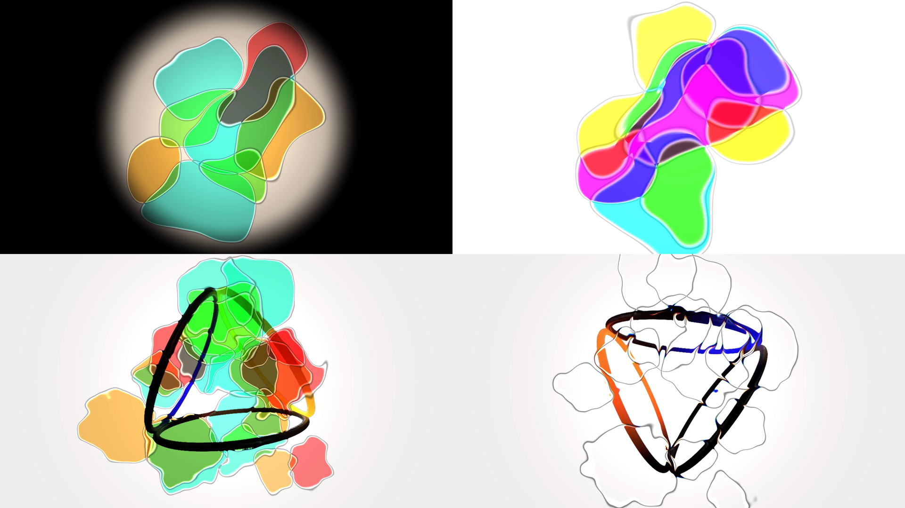

# Flenser user guide

Flenser is a liquid light show (oil, water, alcohol and dye between two watch glasses on an
overhead projector) as an FFGL source and effect for [Resolume](https://resolume.com) Arena and
Avenue, and an OpenFX generator and filter for DaVinci Resolve, Nuke, Natron and Vegas.

All of the oil, and none of the washing up.

*Four looks rendered by the plugin's own offline harness, which drives the real plugin class through a headless GL context, rather than a Resolume screen capture. Clockwise from top left: the wheel seen through a projector's own round gate; the Ink palette, where the crossings go dark because the dyes multiply; a clip put where the lamp was; and the same clip with the dye taken out, so all that's left is the lens at each cell's edge.*

Cells of oil press on each other and join with a fillet. Each one is a dye filter, so
where two cross they **multiply**: cyan over magenta is blue, not white. The meniscus
at every edge is a lens that displaces what's behind it, splits it by wavelength, and
throws a bright caustic just inside a dark rim. Behind all of it is a condenser with a
hot spot, a colour temperature and a round gate.

> **Before you rely on this:** released at **v0.1.6**, whose OpenFX build now renders on
> DaVinci Resolve's Fusion page, with the generator moving there. The model exists twice, once in
> GLSL for the GPU and once in C++ for the OpenFX build, and the two are measured
> against each other across **1.6 million values** over every control, with no
> disagreement past 5e-4. Both builds are separately proved to leave a picture exactly
> as they found it when the wheel is clear: **0 of 230,400 bytes** differ through the
> Resolume build, **0 of 921,600** through the OpenFX one. All 33 controls reach the
> picture, in both bundles.
>
> **What has now been checked in a real host, and what hasn't.** As of v0.1.2 both
> Resolume plugins load and register in Arena 7.27.1 on Windows. That was verified with the
> build this release ships, on a machine with no graphics card, so it says the plugin
> is correct and nothing at all about how fast it is. As of v0.1.6 the OpenFX build
> renders as a Fusion tool in DaVinci Resolve Studio 21.1 on macOS, where v0.1.5's failed
> every frame, and its generator moves there; no other page of Resolve has been tried. The
> Linux build has never been run. Everything else above runs the plugin directly or runs
> the OpenFX bundle through a test host.
>
> Two of the things that were wrong before v0.1.2 weren't caught by any of the measurements
> above: somebody found them running it on a real rig and told me. Check it in your own
> rig before trusting it in a show.

Thirty-three controls, in seven groups. This is what each one does and, more
usefully, what it does *with* the others.

If you read nothing else: **Cells**, **Merge**, **Density** and **Churn** are
the four that decide what the wheel is. The rest is adjustment.

---

## The four plugins

| | Resolume | Resolve / Nuke / Natron / Vegas |
| --- | --- | --- |
| the wheel on its own | **SW Flenser** (a source) | **Flenser** (a generator) |
| the clip as the lamp | **SW Flenser Lamp** (an effect) | **Flenser Lamp** (a filter) |

They declare the same controls and read the same presets. **Mix** doesn't apply
to the generator, and nor do three of **Mode**'s four settings, because they're
about a clip it hasn't got. The fourth, **Matte**, isn't about the clip at all
and both plugins honour it.

---

## Wheel — what is on the glass

**Cells:** how many cells of oil, 1 to 48.

This is the one control that costs. The field walks every cell at every pixel,
in both builds, and the OpenFX build pays for it on the CPU. A real six-inch wheel
holds a few dozen worth looking at; past that they get smaller than the rim
treatment and the picture reads as noise rather than liquid.

**Size:** the average cell radius, where 1.0 is half the frame's short edge.

It's geometric, because the step from two cells filling the gate to four is a
different picture and the step from forty-six to forty-eight isn't.

**Variation:** how much the cells differ in size. At 1 the smallest is about a
tenth of the largest, which is roughly what a dish that's been squeezed looks
like.

**Merge:** the fillet where two cells meet. **The control that decides whether
the wheel is holding beads or pools.**

At 0 the cells stay separate and pass straight through one another. A real dish
doesn't do that, and it's the most useful setting the control has: a field of
hard-edged coloured discs is a mask, a pixel-map driver and a title background.
As it rises they pull into each other with a proper meniscus fillet, which is what
oil in water does when the surface tension is beaten.

The individual cell outlines stay visible however far this goes. In a real
projection they do too: the cells are stacked in the few tenths of a millimetre
between the glasses rather than fused.

**Spread:** how wide the cells are packed. Past about 1.0 the outermost ones
sit beyond the frame, **which is the normal way to run it**: a real wheel is
bigger than the gate.

**Scatter:** at 0 the cells sit on a golden-angle spiral, which is the closest
simple arrangement to a dish full of equal cells pressing on each other, and
stays even at every count. At 1 they're a hashed swarm, a dish that's just
been rocked. Anywhere between is a blend.

**Seed:** a different wheel, 1 to 9999. The presets leave it alone on purpose:
it's how you get a different wheel out of the same look.

---

## Motion

**Speed:** cycles per second, 0 to 1.5. Zero stops everything, including the
cells' slow breathing.

Each cell travels its own closed orbit on two *incommensurate* frequencies, so
the wheel never comes back to where it was. A projection that loops every four
seconds is the one thing an audience does notice.

**Drift:** how far each cell travels on that orbit.

**Spin:** the whole wheel turning in its holder, which is what the motorised
units do. Bipolar: 0.5 is still, and either side is a direction.

**Churn:** how far the noise field deforms the oil, **as a fraction of the
noise's own wavelength**.

This is what stops the cells being circles, and it's the difference between a
liquid light show and a screensaver. It's a fraction rather than a distance so
that it does the same kind of thing at every Grain and can't reach the point
where it folds the field into a mess of contour lines.

**Grain:** how fine that noise is, 0.5 to 12 cells across the wheel. Low is a
slow swell that moves whole cells; high is the boiling texture a projector gets
after a few minutes on.

**Boil:** how fast the noise moves, 0 to 2 Hz. Zero freezes it, which leaves
the cells deformed but still, and that's a useful thing on its own.

> In Resolume, Boil is *integrated*: nudging it changes what happens next
> rather than rescaling the whole history and jumping the field somewhere else.
> In an OpenFX host it's `time × Boil`, because a host that renders frames out
> of order needs each one to be computable on its own. The difference only shows
> while the control is being moved.

---

## Optics — what the light does on its way through

**Density:** how much of the lamp a cell's dye absorbs.

**This is the control that makes the effect subtractive.** Overlapping cells
*multiply* their transmittances, so a cyan cell over a magenta one is blue, and
a red one over a green one is nearly black. That's what a dyed wheel does, and a
stack of coloured blobs added together doesn't. Put this up and watch two cells
cross; the **Ink in Water** preset is built to show it.

**Refraction:** how far the meniscus displaces what's behind it.

It's an edge band rather than a whole-cell distortion: the middle of a cell is flat
oil between two flat glasses and bends light by almost nothing. All the optics are
in the curved boundary at the rim. In **Flenser Lamp** this is the control that
makes the footage visibly *behind* the oil rather than tinted by it.

**Dispersion:** red and blue displaced by different amounts, which is the colour
fringe a thick edge of oil actually makes. Green is left alone, so the picture
doesn't appear to move as the control opens.

**Meniscus:** the dark line at a cell's edge. Light hitting a steep oil-water
boundary is thrown sideways instead of forward, and that's why every cell edge in
a real projection is dark.

**Caustic:** the bright line just inside it, where the same curvature
concentrates the light. It goes past 1 on purpose: a caustic *is* brighter than
the lamp, and the clipping is what the eye reads as wet.

**Rim:** how wide the rim treatment is. At the bottom of its travel it's
about a pixel, which is a projector in sharp focus; at the top it's a wide
soft shoulder.

---

## Colour

**Palette:** the dye set.

| | |
| --- | --- |
| **Aniline** | the four bottles in a supermarket food-colouring pack, which is what the DIY version is actually made with |
| **Ink** | the subtractive primaries. Overlaps most cleanly, because they are what the effect is physically doing anyway |
| **Sodium** | the hot end only: red through orange to amber |
| **Spectrum** | continuous — every cell anywhere on the wheel |
| **Duotone** | two complementary dyes and nothing between them |
| **Mono** | one dye |

**Hue:** rotates the whole palette.

**Hue Spread:** how far apart the palette's dyes sit. At 0 every cell is the
same colour, which is a wheel charged with one bottle and a perfectly reasonable
thing to want.

**Saturation:** how strong the dyes are. Food colouring straight from the
bottle is at the top of this; a wheel that's been run for an hour isn't. At
**0** the wheel is clear water and every mark on the screen is refraction, a
caustic or a meniscus line.

---

## Lamp — the projector behind the glass

In **Flenser Lamp** these describe what the projector does to your clip rather
than what the lamp is. They're left visible there on purpose: a hot spot, a
colour temperature and a gate are things the footage goes through.

**Lamp:** brightness. 0.5 is unity, and the range goes to 2 because a dense
dye at full saturation passes maybe a fifth of the light. Needing to push past
unity to get a picture back is the accurate behaviour.

**Hotspot:** how much brighter the middle of the gate is than the edge. An
overhead projector's condenser is a Fresnel lens, and its hot spot is the first
thing anybody notices about the format.

**Temperature:** bipolar. Below 0.5 is the cold blue-white of a metal halide
head; above it is the amber of a tungsten overhead that's been dimmed.

**Gate:** the round gate's radius. Below 1 the disc and its edge are the
picture, which is an overhead projector with a clock glass on it; **at the very
top of the travel it's off**, and off means off: the frame is full and the
corners are untouched.

**Gate Soft:** how soft that edge is. At 0 it's the hard circle of a
projector in focus.

---

## Simmer — Resolume only

**Off by default, and it's the one part of the plugin that remembers
anything.**

**Simmer** carries a little of the previous frame forward, dragged along the
churn field. It's the one thing the rest of the model can't do: leave a trail
behind a moving cell, because that needs to know where the oil *was*.

**Smear** is how far a carried-forward frame is dragged before it's blended
back. It does nothing with Simmer at 0.

Two things worth knowing:

- At Simmer 0 the picture is **exactly** what it would be without the control
  (the same numbers, not nearly), so switching it on doesn't jump.
- It can't run away. The buffer is a maximum against the live frame with a
  persistence below 1, so nothing in it can ever be brighter than the brightest
  oil that's been through it.

**It doesn't exist in the OpenFX build.** That host renders frames in any
order, alone, on several threads at once, and a feedback buffer there either
serialises it or renders differently every time. An effect that doesn't match
its own preview on the second export is worse than one that's missing a
control.

---

## Output

**Mode:** what the clip is, except for the last one.

| | |
| --- | --- |
| **Project** | the clip goes where the lamp was, and you are looking through the oil at it. The default, and the one the plugin is named for. |
| **Over** | the oil is lit by its own lamp and sits on top of the clip. |
| **Colourise** | only the clip's brightness is used, and the dye supplies all the colour. |
| **Matte** | no clip at all: the lit oil over transparency. Works in **both** plugins. |

**Matte** is the one to reach for if you want the wheel to mask something else.
The oil is lit by its own lamp exactly as in Over, but instead of being laid on
a clip it's laid on nothing, so everywhere the oil doesn't cover, the picture
is transparent, and because the output is premultiplied it's black there too. A
host that ignores alpha still gets the black field; one that doesn't can key it,
put it on a layer above other visuals, or run it through a blend mode.

It's the only mode that renders identically in the generator and the effect,
which is worth knowing: if you're using Matte, it doesn't matter which of the
two plugins you reached for.

Two things it isn't. It isn't a way to get *Over* out of the generator: Over
needs a clip and the generator hasn't got one, and Matte is what you'd use
instead. And it isn't an alpha the wheel's own shape gives you for free: what
sets the transparency is how much light each pixel actually intercepts, so a
pale dye at low Density cuts a fainter matte than a saturated one does. Turn
Density up if you want a harder edge.

**Mix:** dry/wet against the untouched clip. **Flenser Lamp only.**

---

## Recipes

**A wash to sit under titles.** *Slow Bloom*, then Density down to about 0.4 and
Mix to taste. Three enormous cells barely moving.

**A mask or a pixel-map driver.** *Beading*. Merge at 0, Saturation at 1, Rim
low: hard-edged coloured discs with no soft shoulder to confuse a mapper.

**Footage that's actually behind glass.** *Clear Water* on **Flenser Lamp**, Mode
Project. No dye at all, so nothing is tinted; every mark on the picture is the
lens.

**The DIY article.** *Overhead Projector*, then Gate down to about 0.55 for a
smaller clock glass and Speed up a little if it's too static for the cue.

**Something that boils.** *Alcohol Burn*, then Boil up and Grain up together.
Leave Churn where the preset put it: it's normalised against Grain, so raising
Grain makes it finer rather than wilder.

---

## What it costs

The field walks every cell at every pixel. So:

- **Cells is linear** in render cost. Forty-eight is roughly four times
  twelve.
- **Simmer adds a pass** at full resolution, and is skipped entirely when it's
  zero.
- **Everything else is free.** Refraction, Dispersion, the rim treatment and
  the whole lamp are a fixed handful of instructions per pixel whatever they're
  set to.

`./build/fltest --bench` prints the numbers for your own machine.

---

## When it does nothing

The log is the first place to look:

    ~/Library/Logs/flenser/flenser.YYYY-MM-DD.log

It records the GL vendor and version, any shader that wouldn't compile, and
any buffer the driver wouldn't allocate. Those are the three failures that
look identical from the operator's side: the effect just does nothing, with
no message anywhere.
